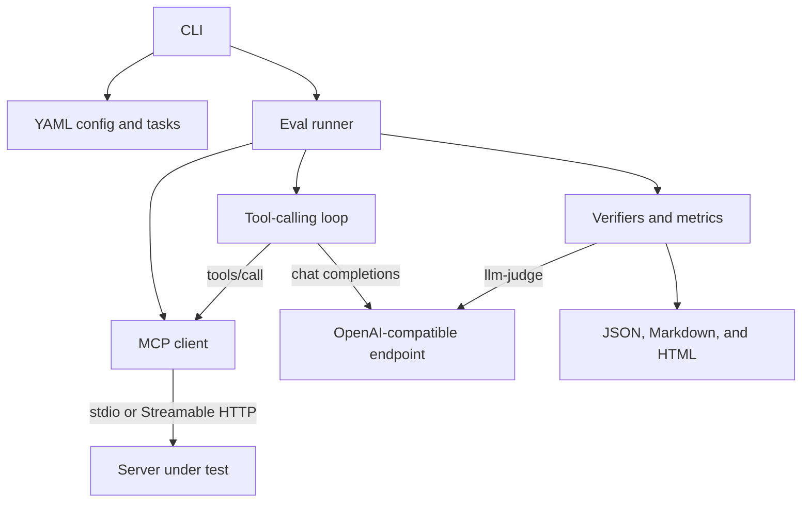

# mcp-tool-evals

`mcp-tool-evals` checks whether a model selects the right tool on an MCP server, calls it with valid arguments, and produces an answer that passes a verifier.

Promptfoo and DeepEval score the text a model returns. They have no notion of an MCP server, a tool schema, or a tool call. The MCP server testers that do exist are small projects and have gone quiet. Anthropic's post [Writing effective tools for agents — with agents](https://www.anthropic.com/engineering/writing-tools-for-agents) describes this measurement and ships it as a notebook. This repository is that measurement as a TypeScript CLI: point it at any MCP server, a YAML task file, and one OpenAI-compatible endpoint that can serve Claude, GPT, Grok, Venice, or an open model.

## Quick start

Node.js 20 or newer.

```bash
git clone https://github.com/harmenx/mcp-tool-evals.git
cd mcp-tool-evals
npm install
npm run demo
```

`npm run demo` starts a local OpenAI-compatible stand-in, connects to the bundled bookstore server over stdio, and runs six tasks. No API key is required. The process prints a progress line per task and then the Markdown summary.

To call real models, put them behind one OpenAI-compatible base URL (a LiteLLM proxy is the usual setup) and export its key:

```bash
export OPENAI_BASE_URL=http://127.0.0.1:4000/v1
export OPENAI_API_KEY=sk-...
npm run build
node dist/cli.js init
# edit mcp-tool-evals.yaml so `server` launches your MCP server
node dist/cli.js generate -c mcp-tool-evals.yaml -o tasks.yaml
node dist/cli.js run -c mcp-tool-evals.yaml
```

`run` exits 0 when every task passes and 1 when any task fails, so a CI job can gate on it. `--allow-failures` prints the report and exits 0 anyway.

## What a run measures

Each task is one user prompt. For every model the runner opens the server, lists its tools, and runs a short tool-calling loop: send the prompt and the tool schemas, execute any tool call on the server, send the result back, and stop when the model answers or `limits.maxTurns` is reached. A judge call, when a task asks for one, is a separate request and is not counted in that model's token totals.

| Metric | Definition |
| --- | --- |
| Task success | The verifier accepts the model's final answer. |
| Right-tool rate | Share of tasks where every tool in `expect.tools` was called at least once and no tool in `expect.forbid` was called. Tasks that list neither are left out of the rate. |
| Valid-argument rate | Share of tool calls whose arguments match the tool's JSON Schema and the task's argument checks. A call to a tool with no checks is valid when the schema accepts it. A run with no calls leaves the rate blank. |
| Tool calls | How many calls the model made. |
| Tokens | Prompt and completion tokens reported by the endpoint, summed across the tool-calling loop. |
| Latency | Wall time of the tool-calling loop, including the server. |
| Cost | Token counts times `inputPerMillion` and `outputPerMillion` (USD per million tokens). Blank when both prices are omitted. |

The three numbers answer different questions. On the bookstore tasks the bundled stand-in shows the split:

| Model id | Task success | Right tool | Valid arguments |
| --- | --- | --- | --- |
| `mock-good` | 6/6 | 6/6 | 6/6 |
| `mock-wrong-tool` | 0/6 | 1/6 | 5/6 |
| `mock-bad-args` | 0/6 | 6/6 | 0/6 |

`mock-wrong-tool` calls `calculate` for every prompt, so the arithmetic task counts as the right tool and the catalog tasks do not. `mock-bad-args` names the right tool and sends arguments the schema rejects. The stand-in's judge passes when every quoted phrase in the criteria appears in the answer. A real judge is just another model on the same endpoint, named by `judge.model`.

## Example config

Paths inside the file are relative to the file. `${VAR}` and `${VAR:-fallback}` are read from the environment.

```yaml
server:
  transport: stdio
  command: node
  args: ["server.js"]
  # transport: http
  # url: https://example.com/mcp
  # headers:
  #   Authorization: Bearer ${MCP_TOKEN}

provider:
  baseUrl: ${OPENAI_BASE_URL:-https://api.openai.com/v1}
  apiKeyEnv: OPENAI_API_KEY

models:
  - name: claude
    model: anthropic/claude-sonnet-4-5
    inputPerMillion: 3      # illustrative; set these from your provider
    outputPerMillion: 15
  - name: gpt
    model: openai/gpt-4.1
    inputPerMillion: 2
    outputPerMillion: 8
  - name: grok
    model: xai/grok-4

tasks: tasks.yaml

limits:
  maxTurns: 4
  timeoutMs: 60000

judge:
  model: anthropic/claude-sonnet-4-5

output:
  json: results.json
  markdown: summary.md
```

The runnable copy for the bookstore is [`examples/bookstore/mcp-tool-evals.yaml`](examples/bookstore/mcp-tool-evals.yaml). `init` writes a starter file in the current directory.

HTTP servers use Streamable HTTP. The client sends `headers` on every request. stdio servers are spawned as a child process; `env` is merged onto a small default (`PATH` and the other variables the MCP SDK inherits). stdout belongs to the protocol, so a server has to log on stderr.

## Example tasks

[`examples/bookstore/tasks.yaml`](examples/bookstore/tasks.yaml) is the full file. A task names the tools it expects, optional argument checks, and one verifier: `exact`, `regex`, or `llm-judge`.

```yaml
tasks:
  - id: dune-price
    prompt: What is the price of the book titled Dune?
    expect:
      tools: [search_books]
      forbid: [calculate]
      arguments:
        search_books:
          query:
            equals: Dune
    verifier:
      type: regex
      pattern: '9\.99'

  - id: multiply
    prompt: What is 15 multiplied by 4?
    expect:
      tools: [calculate]
      arguments:
        calculate:
          op: { equals: mul }
          a: { equals: 15 }
          b: { equals: 4 }
    verifier:
      type: exact
      value: "60"

  - id: dune-stock
    prompt: Is the book titled Dune in stock, and what does it cost?
    expect:
      tools: [search_books]
    verifier:
      type: llm-judge
      criteria: The answer must include "9.99" and "in stock".
```

Argument checks are `equals`, `contains`, `regex`, and `type`. They are combined with AND. Schema checks cover the usual tool-schema subset: type, enum, const, required, properties, additionalProperties, items, and string and number bounds.

`generate` asks the configured model to draft tasks from the live tool list. Review the file before trusting it. The command refuses to overwrite an existing tasks file unless you pass `--force`. Against the bundled stand-in, `generate` returns one draft per tool so the command can be tested with no API key.

## Example report

This is one `npm run demo` run against the bookstore server and `mock-good`. Token counts are fixed for that stand-in; latency moves a little between runs. Cost is blank because the example model has no prices set.

```text
pass  mock  dune-price  tools=1  tokens=225  34ms
pass  mock  neuromancer-author  tools=1  tokens=227  6ms
pass  mock  scifi-shelf  tools=1  tokens=295  5ms
pass  mock  lookup-dune  tools=1  tokens=221  5ms
pass  mock  multiply  tools=1  tokens=197  8ms
pass  mock  dune-stock  tools=1  tokens=231  3ms
```

```markdown
# mcp-tool-evals

| Field | Value |
| --- | --- |
| Server | bookstore 1.0.0 |
| Transport | stdio `node --import tsx server.ts` |
| Tools | search_books, get_book, list_by_tag, calculate |
| Started | 2026-11-22T00:47:19.098Z |

## mock

Model `mock-good`.

| Task | Success | Right tool | Valid args | Tool calls | Tokens | Latency | Cost |
| --- | --- | --- | --- | --- | --- | --- | --- |
| dune-price | pass | pass | 1/1 | 1 | 225 | 34ms | — |
| neuromancer-author | pass | pass | 1/1 | 1 | 227 | 6ms | — |
| scifi-shelf | pass | pass | 1/1 | 1 | 295 | 5ms | — |
| lookup-dune | pass | pass | 1/1 | 1 | 221 | 5ms | — |
| multiply | pass | pass | 1/1 | 1 | 197 | 8ms | — |
| dune-stock | pass | pass | 1/1 | 1 | 231 | 3ms | — |

| Metric | Value |
| --- | --- |
| Task success | 100% (6/6) |
| Right-tool rate | 100% (6/6) |
| Valid-argument rate | 100% (6/6) |
| Tool calls | 6 (mean 1) |
| Tokens | 1396 (prompt 1259, completion 137) |
| Latency | 61ms (mean 10ms) |
| Cost | — |

### Failures

None.
```

The same run is written three ways. JSON has the raw numbers (`version`, server, tools, and one object per model with a summary plus every tool call). Markdown is the table above. HTML is a single file with the same summary and a drill-down per task (prompt, answer, verifier, and each call). It uses no external images, fonts, or scripts. `--json`, `--markdown`, and `--html` override the paths in the config.

## Commands

```text
mcp-tool-evals run      --config mcp-tool-evals.yaml
mcp-tool-evals tools    --config mcp-tool-evals.yaml
mcp-tool-evals generate --config mcp-tool-evals.yaml --out tasks.yaml --count 4
mcp-tool-evals init     --dir .
mcp-tool-evals diff     --current results.json --baseline baseline.json --threshold 0.05
```

| Flag | Use |
| --- | --- |
| `-c, --config` | Config file. Required except for `init`. |
| `-o, --out` | Where `generate` writes tasks. |
| `-n, --count` | How many tasks to draft (1–20, default 4). |
| `-m, --model` | Model id for `generate`. Defaults to `judge.model`, then the first model. |
| `--json`, `--markdown`, `--html` | Override the report paths for `run`. |
| `--current`, `--baseline` | Results file and baseline file for `diff`. |
| `--threshold` | Allowed drop in task success, from 0 to 1. `0.05` is five percentage points. Default 0. |
| `--require-perfect` | Fail `diff` when any model's success rate is below 1. |
| `-f, --force` | Overwrite an existing config or tasks file. |
| `-v, --verbose` | Server stderr and the arguments of each call. |
| `--allow-failures` | Exit 0 even when a task fails. |

From a checkout, `npm run mcp-tool-evals -- run -c examples/bookstore/mcp-tool-evals.yaml` runs the TypeScript entry without a build. `npm run build` writes `dist/cli.js`.

The model endpoint must accept `POST {baseUrl}/chat/completions` with `tools` and return OpenAI-style `tool_calls` and `usage.prompt_tokens` / `usage.completion_tokens`. The key is read from the environment variable named by `provider.apiKeyEnv` and sent as a bearer token.

## Architecture



The CLI is a thin wrapper around `runEval`, which is exported from the package for a programmatic caller. One model finishes before the next begins, and each model gets its own connection, so a crashed server does not leak into the next model. Tool calls inside a turn run one after another.

The client and server libraries are the official MCP TypeScript SDK, `@modelcontextprotocol/client` and `@modelcontextprotocol/server`. Those packages are the current SDK line and replace the older single package `@modelcontextprotocol/sdk`.

```text
src/                 config, MCP session, model client, loop, scoring, reports, CLI
action.yml           composite GitHub Action
benchmark/           task sets for ten public MCP servers, and a runner
examples/bookstore/  catalog server, tasks, config, and a success-rate baseline
examples/mock-openai/ deterministic chat endpoint used by the tests and the demo
examples/workflows/  example workflow that calls the action
tests/               vitest, no network, no real API keys
```

## GitHub Action

`action.yml` is a composite action. It installs and builds this repo, runs the config you pass, uploads `report.html`, `summary.md`, and `results.json` as artifacts, and appends the Markdown summary to the job summary. If `baseline` is set, the job fails when any model's task success rate drops by more than `threshold`. Without a baseline, the job fails unless every task passed.

```yaml
- uses: actions/checkout@v4
- uses: actions/setup-node@v4
  with:
    node-version: 22
- uses: harmenx/mcp-tool-evals@main
  with:
    config: mcp-tool-evals.yaml
    baseline: baseline.json
    threshold: "0.05"
  env:
    OPENAI_BASE_URL: ${{ vars.OPENAI_BASE_URL }}
    OPENAI_API_KEY: ${{ secrets.OPENAI_API_KEY }}
```

A copy that runs the bookstore tasks against the mock model is in [`examples/workflows/mcp-tool-evals.yml`](examples/workflows/mcp-tool-evals.yml). `.github/workflows/eval.yml` is that same job, and it is what CI runs. The baseline is [`examples/bookstore/baseline.json`](examples/bookstore/baseline.json): the mock model passes all six tasks. The file can also be a previous `results.json`; `diff` reads `summary.taskSuccessRate` from a full report, or `taskSuccessRate` from a short `{ "models": [...] }` file.

## Benchmark

[`benchmark/`](benchmark/README.md) holds task sets for ten public servers: the reference filesystem, memory, everything, sequential thinking, fetch, git, and time servers, plus Playwright, Context7, and GitHub. `npm run benchmark -- --dry-run` prints the plan. A real run needs the server's own runtime (`npx`, `uvx`, or Docker) and a model endpoint. The configs default to the mock model so CI never calls a hosted model. No table of model scores is checked in, because none has been measured on a real model yet.

## Development

```bash
npm test
npm run lint
npm run typecheck
npm run build
```

CI on GitHub Actions runs lint, typecheck, tests, and the build on Node 20 and Node 22. A second workflow runs the composite action against the bookstore server and the mock model. The tests spawn the bookstore server over stdio and Streamable HTTP. Nothing in the suite calls a hosted model.

## Roadmap

- Publish benchmark numbers once the ten servers have been run on real models.
- A before/after mode for tool-description rewrites: same tasks, same models, two server builds, one diff.

## License

[MIT](LICENSE) © 2026 Harmen Dark
